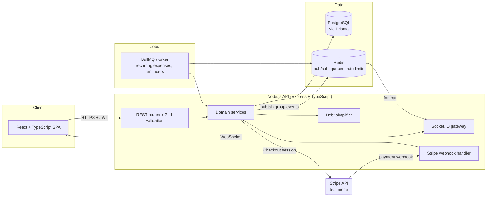

# SplitPay

**Real-time group expense splitting and settlement.** Roommates, trip groups and teams add shared expenses, see live balances, and settle up with a minimal number of payments, paid through Stripe (test mode).

> Status: feature-complete source project with integration tests. Runs locally with Docker Compose; not deployed.

---

## The problem

Shared expenses are a constant source of friction: someone pays rent, someone else buys groceries, a third person books the cabin. Spreadsheets drift out of date, people forget who owes whom, and settling up often takes far more transfers than necessary. With 6 people who all paid for something, naive settlement can need up to 15 payments; SplitPay needs at most 5.

## What it does

| Feature | Details |
| --- | --- |
| **Groups** | Create a group, invite members by link, assign a default currency |
| **Expenses** | Split equally, by exact amounts, by percentages or by shares; attach a receipt |
| **Live balances** | Every member's balance updates instantly for everyone in the group over WebSockets |
| **Accounts** | Email and password sign-up, RS256 access tokens, rotating refresh tokens with reuse detection |
| **Debt simplification** | Greedy min-cash-flow algorithm turns the web of debts into the fewest transfers |
| **Settle up** | Pay a suggested transfer through Stripe Checkout (test mode); a webhook marks it settled |
| **Recurring expenses** | Rent and subscriptions are added automatically on a schedule (BullMQ jobs) |
| **Activity feed** | Every change is recorded and shown in a per-group timeline |

## Architecture



More diagrams (sequence, class, ER, state, activity, deployment) are in [`docs/`](docs/).

## Tech stack

| Layer | Technology |
| --- | --- |
| API | Node.js 20, Express, TypeScript, Zod |
| Data access | Prisma ORM, PostgreSQL 16 |
| Real time | Socket.IO; every API instance and the job worker share a Redis pub/sub channel |
| Jobs | BullMQ on Redis |
| Payments | Stripe Checkout and webhooks (test mode only) |
| Auth | JWT (RS256) access tokens, refresh tokens in httpOnly cookies |
| Frontend | React 18, TypeScript, Vite, TanStack Query |
| Quality | Vitest, Supertest, ESLint, Prettier, GitHub Actions CI |

## Quick start

```bash
cp .env.example .env        # add an RS256 key pair and Stripe test keys (instructions inside)
docker compose up           # postgres, redis, api, worker, web
```

- Web app: http://localhost:5173
- API: http://localhost:4000

To receive Stripe webhooks locally, run `stripe listen --forward-to localhost:4000/webhooks/stripe` with the Stripe CLI and put the `whsec_` value it prints in `.env`. Pay with test card `4242 4242 4242 4242`.

## API

| Method | Path | Purpose |
| --- | --- | --- |
| POST | `/auth/register`, `/auth/login` | Create a session (access token + refresh cookie) |
| POST | `/auth/refresh`, `/auth/logout` | Rotate or revoke the refresh token |
| GET/POST | `/groups` | List or create groups |
| GET | `/groups/:id` | Members, balances and suggested transfers |
| POST | `/groups/:id/invites`, `/invites/:token/accept` | Invite links |
| GET/POST/DELETE | `/groups/:id/expenses` | Expenses (cursor pagination, idempotency keys) |
| GET | `/groups/:id/settlements` | Settlement history and suggested transfers |
| POST | `/groups/:id/settlements/checkout` | Start a Stripe Checkout payment |
| POST | `/groups/:id/settlements/cash` | Receiver records a cash payment |
| GET/POST/DELETE | `/groups/:id/recurring` | Recurring expenses (BullMQ job schedulers) |
| POST | `/webhooks/stripe` | Signed Stripe events |

## Tests

```bash
docker run -d -p 55433:5432 -e POSTGRES_USER=splitpay -e POSTGRES_PASSWORD=splitpay -e POSTGRES_DB=splitpay_test postgres:16
docker run -d -p 56379:6379 redis:7-alpine
cd apps/api && npm install && npx prisma generate && npm test
```

29 tests run against real PostgreSQL and Redis: split maths, debt simplification, auth and token rotation, membership rules, idempotency, Stripe webhook signatures and duplicate deliveries, cash settlements, BullMQ scheduling, and WebSocket fan-out. Stripe Checkout creation is the only faked call.

## Project structure

```
splitpay/
├── apps/
│   ├── api/
│   │   ├── prisma/schema.prisma      # data model
│   │   ├── src/
│   │   │   ├── index.ts              # HTTP + WebSocket server bootstrap
│   │   │   ├── app.ts                # Express app, middleware, routes
│   │   │   ├── config.ts             # env parsing with Zod
│   │   │   ├── domain/               # pure logic: splits, debt simplifier
│   │   │   ├── modules/              # auth, groups, expenses, balances, settlements
│   │   │   ├── realtime/             # Socket.IO gateway (Redis pub/sub)
│   │   │   ├── jobs/                 # BullMQ recurring expenses
│   │   │   ├── worker.ts             # job worker entry point
│   │   │   └── lib/                  # prisma, redis, stripe clients
│   │   └── test/
│   └── web/                          # React + Vite SPA
├── docs/
│   ├── architecture.md
│   ├── diagrams/                     # sequence, class, ER, state, activity, deployment
│   └── adr/
├── docker-compose.yml
├── .env.example
└── .github/workflows/ci.yml
```

## Skills demonstrated

Node.js · Express · TypeScript · Prisma ORM · Zod · PostgreSQL · Redis · WebSockets (Socket.IO) · BullMQ · Stripe payments and webhooks · JWT (RS256) · React · algorithms (min cash flow) · event-driven design · Docker · CI/CD

## Status

- [x] Architecture, diagrams and design decisions
- [x] Debt simplification and split calculator
- [x] Auth with rotating refresh tokens, groups and invites
- [x] Expenses with idempotency keys and ledger-derived balances
- [x] Real-time updates over WebSockets
- [x] Stripe Checkout settlement with signed, idempotent webhooks
- [x] Recurring expenses with BullMQ
- [x] React web app
- [ ] Multi-currency groups with exchange rates
- [ ] Receipt scanning (OCR)

## License

MIT
