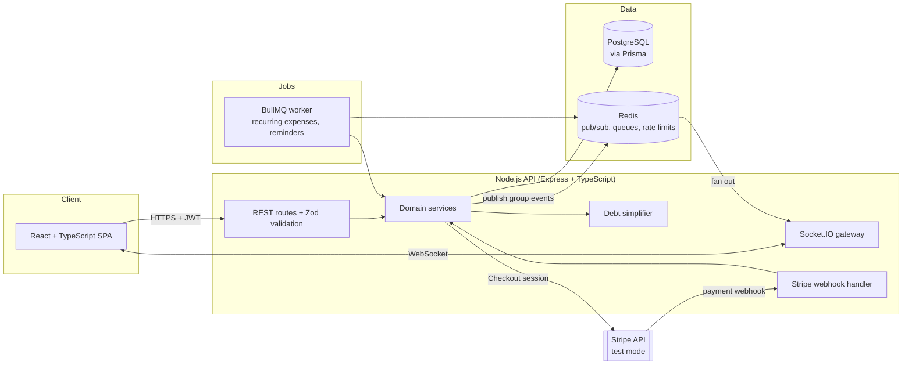

# SplitPay

**Real-time group expense splitting and settlement.** Roommates, trip groups and teams add shared expenses, see live balances, and settle up with a minimal number of payments, paid through Stripe (test mode).

> Status: architecture and project skeleton. Source-only project, runs locally with Docker Compose. Not deployed.

---

## The problem

Shared expenses are a constant source of friction: someone pays rent, someone else buys groceries, a third person books the cabin. Spreadsheets drift out of date, people forget who owes whom, and settling up often takes far more transfers than necessary. With 6 people who all paid for something, naive settlement can need up to 15 payments; SplitPay needs at most 5.

## What it does

| Feature | Details |
| --- | --- |
| **Groups** | Create a group, invite members by link, assign a default currency |
| **Expenses** | Split equally, by exact amounts, by percentages or by shares; attach a receipt |
| **Live balances** | Every member's balance updates instantly for everyone in the group over WebSockets |
| **Debt simplification** | Greedy min-cash-flow algorithm turns the web of debts into the fewest transfers |
| **Settle up** | Pay a suggested transfer through Stripe Checkout (test mode); a webhook marks it settled |
| **Recurring expenses** | Rent and subscriptions are added automatically on a schedule (BullMQ jobs) |
| **Activity feed** | Every change is recorded and shown in a per-group timeline |

## Architecture



More diagrams (sequence, class, ER, state, activity, deployment) are in [`docs/`](docs/).

## Tech stack

| Layer | Technology |
| --- | --- |
| API | Node.js 20, Express, TypeScript, Zod |
| Data access | Prisma ORM, PostgreSQL 16 |
| Real time | Socket.IO with Redis adapter (horizontal scaling) |
| Jobs | BullMQ on Redis |
| Payments | Stripe Checkout and webhooks (test mode only) |
| Auth | JWT (RS256) access tokens, refresh tokens in httpOnly cookies |
| Frontend | React 18, TypeScript, Vite, TanStack Query |
| Quality | Vitest, Supertest, ESLint, Prettier, GitHub Actions CI |

## Quick start

```bash
cp .env.example .env        # add Stripe test keys
docker compose up --build   # postgres, redis, api, web
npm run db:migrate --workspace api
```

- Web app: http://localhost:5173
- API: http://localhost:4000

To receive Stripe webhooks locally, run `stripe listen --forward-to localhost:4000/webhooks/stripe` with the Stripe CLI.

## Project structure

```
splitpay/
├── apps/
│   ├── api/
│   │   ├── prisma/schema.prisma      # data model
│   │   ├── src/
│   │   │   ├── index.ts              # HTTP + WebSocket server bootstrap
│   │   │   ├── app.ts                # Express app, middleware, routes
│   │   │   ├── config.ts             # env parsing with Zod
│   │   │   ├── domain/               # pure logic: splits, debt simplifier
│   │   │   ├── modules/              # auth, groups, expenses, balances, settlements
│   │   │   ├── realtime/             # Socket.IO gateway
│   │   │   ├── jobs/                 # BullMQ workers
│   │   │   └── lib/                  # prisma, redis, stripe clients
│   │   └── test/
│   └── web/                          # React + Vite SPA
├── docs/
│   ├── architecture.md
│   ├── diagrams/                     # sequence, class, ER, state, activity, deployment
│   └── adr/
├── docker-compose.yml
├── .env.example
└── .github/workflows/ci.yml
```

## Skills demonstrated

Node.js · Express · TypeScript · Prisma ORM · Zod · PostgreSQL · Redis · WebSockets (Socket.IO) · BullMQ · Stripe payments and webhooks · JWT (RS256) · React · algorithms (min cash flow) · event-driven design · Docker · CI/CD

## Roadmap

- [x] Architecture, diagrams and project skeleton
- [x] Debt simplification algorithm with tests
- [x] Expense split calculator with tests
- [ ] Auth and groups
- [ ] Expenses and live balances
- [ ] Stripe settlement flow
- [ ] Recurring expenses
- [ ] Web app

## License

MIT
