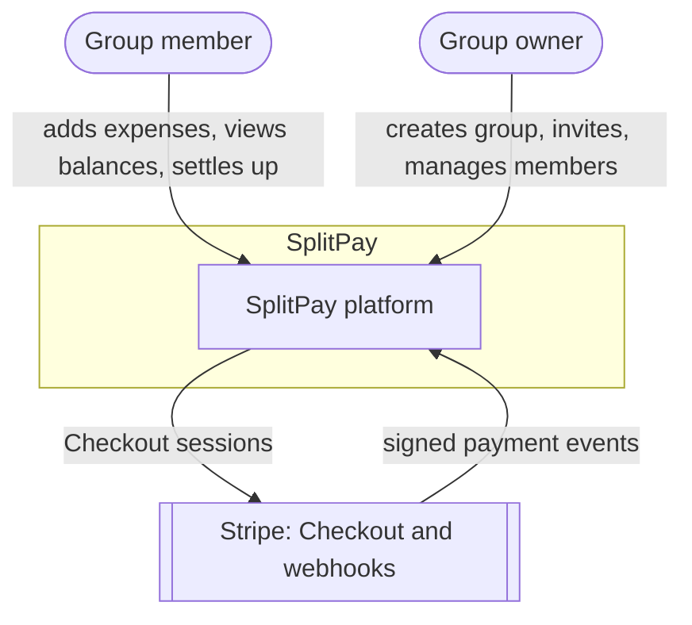
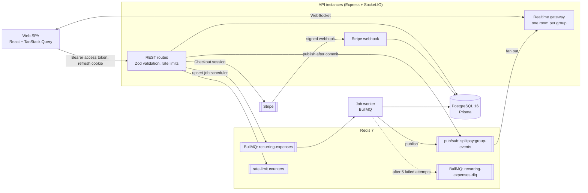
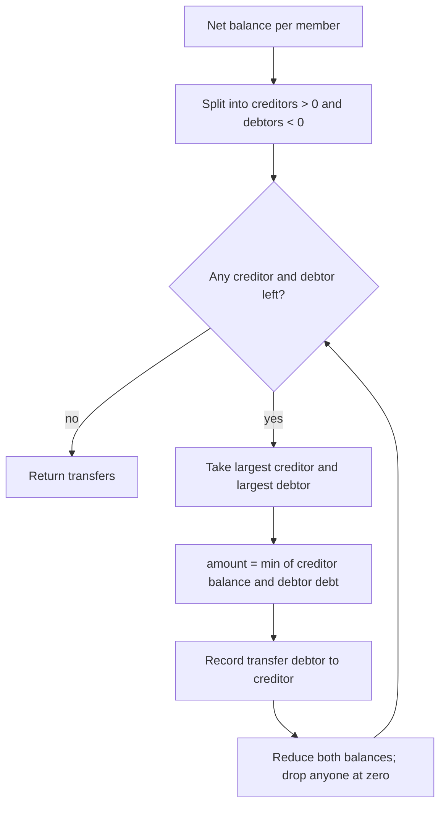
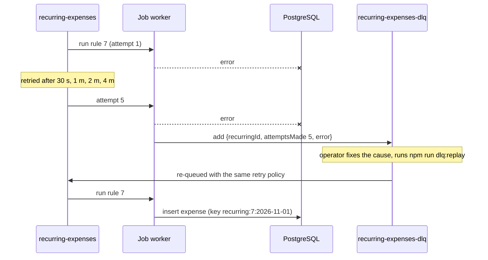

# SplitPay architecture

## 1. Goals and constraints

| Goal | How the design addresses it |
| --- | --- |
| Money is never wrong | Amounts are stored as integer minor units (cents); splits distribute rounding remainders deterministically; balances are derived from ledger entries, never edited directly |
| Everyone sees changes instantly | Every write publishes a group event on Redis; Socket.IO pushes it to members of that group's room |
| Fewest possible payments | A greedy min-cash-flow algorithm produces at most n − 1 transfers for n members |
| Nothing happens twice | Expenses accept an idempotency key, recurring runs have one key per rule and day, and Stripe webhooks are processed once per event ID |
| Failures are recoverable | Recurring jobs retry with exponential backoff, then land in a dead-letter queue that can be replayed |
| Scales horizontally | Stateless API instances; every instance subscribes to one Redis pub/sub channel and emits to its own sockets |

## 2. System context

Invites are shareable links (`/invite/:token`, valid 7 days); there is no email integration yet.

## 3. Containers

| Container | Responsibility | Tech |
| --- | --- | --- |
| **Web** | Group dashboard, expense forms, balances, settle-up; refetches a group's data whenever an event for it arrives | React, TypeScript, Vite, TanStack Query |
| **API** | REST endpoints, validation, business rules, auth, Stripe integration | Express, TypeScript, Zod |
| **Realtime gateway** | Authenticated WebSocket connections, one room per group, fed by the Redis pub/sub channel | Socket.IO in the API process |
| **Job worker** | Recurring expenses; 5 attempts with exponential backoff, then the dead-letter queue (`npm run dlq:replay` re-queues) | BullMQ |
| **PostgreSQL** | Users, refresh-token hashes, groups, expenses, splits, settlements, recurring rules, activity, invites | Prisma |
| **Redis** | Pub/sub for group events, BullMQ queues, rate-limit counters | Redis 7 |

## 4. Balances and the ledger

Every expense creates one **payer credit** and one **debit per participant**. A member's balance is the sum of their credits minus their debits, plus completed settlements. Balances are recomputed from the ledger in a single SQL aggregate, so there is no stored balance that can drift.

## 5. Debt simplification

Implemented in `apps/api/src/domain/debtSimplifier.ts`, with tests.

## 6. Reliability and idempotency

| Operation | Duplicate cause | Protection |
| --- | --- | --- |
| Add expense | Client retry, double click | Optional `idempotencyKey` (unique index). A repeat returns the original expense with `200`; if two identical requests race, the unique index lets one insert win and the other returns the winner's expense |
| Recurring expense run | Job retry, duplicate job | Key `recurring:<rule>:<UTC date>`, so a period produces at most one expense |
| Stripe webhook | Stripe redelivers events | Signature verified; skipped if the event ID is already stored; status changes only `WHERE status = 'PENDING'` |
| Recurring job failure | Database or Redis outage | 5 attempts with exponential backoff (30 s, 1 m, 2 m, 4 m); after the last attempt the job is copied to `recurring-expenses-dlq` with the error, then replayed with `npm run dlq:replay` |
| Missed real-time event | Socket disconnected | Delivery is at-most-once; the client refetches everything on reconnect |

## 7. Security

- **Authentication:** RS256-signed JWT access tokens (15 min) and single-use refresh tokens (30 days) in an httpOnly, SameSite=Strict cookie (Secure in production). Only a SHA-256 hash of each refresh token is stored. Every refresh rotates the token, and reusing a revoked one revokes every session for that user. Passwords are hashed with bcrypt (cost 12)
- **Authorization:** every group route checks membership; only owners can remove members or delete the group; only the receiver can record a cash payment
- **Validation:** all request bodies and query strings are parsed with Zod schemas
- **Payments:** no card data touches SplitPay; webhook signatures are verified and event IDs are stored to prevent double-processing
- **Abuse:** Redis-backed fixed-window rate limits: 10 requests per minute on auth endpoints, 120 per minute on expense writes

## 8. Scaling

| Part | How it scales | Limit to watch |
| --- | --- | --- |
| API | Stateless: run more instances behind a load balancer. Clients use the WebSocket transport, so no sticky sessions | Postgres connections; add PgBouncer |
| Real time | Each instance subscribes to the one Redis channel and emits only to its own sockets | Every instance receives every event; at very high volume, shard channels by group |
| Jobs | Run more worker processes on the same BullMQ queue | Redis memory for job history (completed and failed jobs are capped) |
| Balances | One SQL aggregate per group read | Very large groups: cache per-group balances, invalidated by the same events |

## 9. Diagrams

| Diagram | File |
| --- | --- |
| Use cases | [diagrams/use-cases.md](diagrams/use-cases.md) |
| Sequence: add expense and live update | [diagrams/sequence-add-expense.md](diagrams/sequence-add-expense.md) |
| Sequence: settle up with Stripe | [diagrams/sequence-settle-up.md](diagrams/sequence-settle-up.md) |
| Sequence: recurring expense job | [diagrams/sequence-recurring-expense.md](diagrams/sequence-recurring-expense.md) |
| Class diagram | [diagrams/class-diagram.md](diagrams/class-diagram.md) |
| Entity-relationship | [diagrams/er-diagram.md](diagrams/er-diagram.md) |
| Settlement state machine | [diagrams/state-settlement.md](diagrams/state-settlement.md) |
| Activity: add expense | [diagrams/activity-add-expense.md](diagrams/activity-add-expense.md) |
| Deployment | [diagrams/deployment.md](diagrams/deployment.md) |

## 10. Decisions

- [ADR-0001: Store money as integer minor units](adr/0001-integer-money.md)
- [ADR-0002: Derive balances from a ledger](adr/0002-ledger-balances.md)
- [ADR-0003: Redis pub/sub for real-time fan-out](adr/0003-redis-pubsub.md)
