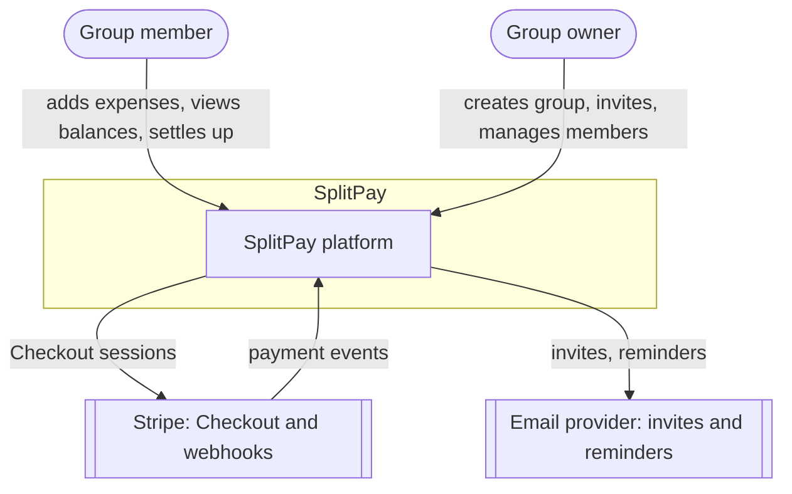
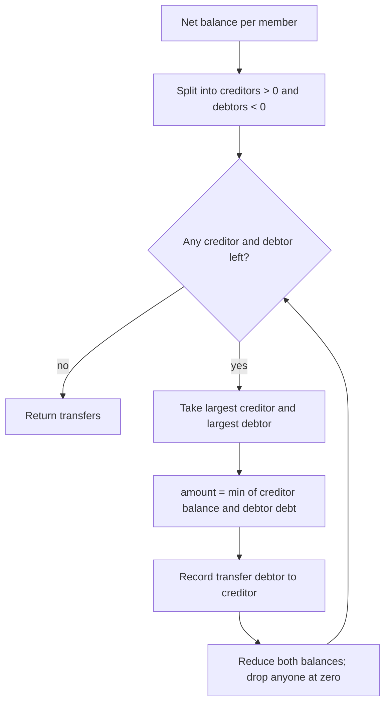

# SplitPay architecture

## 1. Goals and constraints

| Goal | How the design addresses it |
| --- | --- |
| Money is never wrong | Amounts are stored as integer minor units (cents); splits distribute rounding remainders deterministically; balances are derived from ledger entries, never edited directly |
| Everyone sees changes instantly | Every write publishes a group event on Redis; Socket.IO pushes it to members of that group's room |
| Fewest possible payments | A greedy min-cash-flow algorithm produces at most n − 1 transfers for n members |
| Payments are safe and idempotent | Stripe Checkout handles card data; webhooks are verified by signature and processed once using the event ID |
| Scales horizontally | Stateless API instances; every instance subscribes to one Redis pub/sub channel and emits to its own sockets |

## 2. System context

## 3. Containers

| Container | Responsibility | Tech |
| --- | --- | --- |
| **Web** | Group dashboard, expense forms, balances, settle-up | React, TypeScript, Vite |
| **API** | REST endpoints, validation, business rules, Stripe integration | Express, TypeScript, Zod |
| **Realtime gateway** | Authenticated WebSocket connections, one room per group, fed by a Redis pub/sub channel | Socket.IO in the API process |
| **Job worker** | Recurring expenses, payment reminders | BullMQ |
| **PostgreSQL** | Users, groups, expenses, splits, settlements, activity | Prisma |
| **Redis** | Pub/sub for group events, BullMQ queues, rate-limit counters | Redis 7 |

## 4. Balances and the ledger

Every expense creates one **payer credit** and one **debit per participant**. A member's balance is the sum of their credits minus their debits, plus completed settlements. Balances are recomputed from the ledger in a single SQL aggregate, so there is no stored balance that can drift.

## 5. Debt simplification

Implemented in `apps/api/src/domain/debtSimplifier.ts`, with tests.

## 6. Security

- **Auth:** RS256-signed JWT access tokens (15 min) and single-use refresh tokens in httpOnly, SameSite=Strict cookies; reusing a revoked refresh token revokes every session for that user
- **Authorization:** every group route checks membership; only owners can remove members or delete the group
- **Validation:** all request bodies and query strings are parsed with Zod schemas; unknown fields are rejected
- **Payments:** no card data touches SplitPay; webhook signatures are verified and event IDs are stored to prevent double-processing
- **Abuse:** Redis-backed rate limits on auth and write endpoints

## 7. Diagrams

| Diagram | File |
| --- | --- |
| Use cases | [diagrams/use-cases.md](diagrams/use-cases.md) |
| Sequence: add expense and live update | [diagrams/sequence-add-expense.md](diagrams/sequence-add-expense.md) |
| Sequence: settle up with Stripe | [diagrams/sequence-settle-up.md](diagrams/sequence-settle-up.md) |
| Sequence: recurring expense job | [diagrams/sequence-recurring-expense.md](diagrams/sequence-recurring-expense.md) |
| Class diagram | [diagrams/class-diagram.md](diagrams/class-diagram.md) |
| Entity-relationship | [diagrams/er-diagram.md](diagrams/er-diagram.md) |
| Settlement state machine | [diagrams/state-settlement.md](diagrams/state-settlement.md) |
| Activity: add expense | [diagrams/activity-add-expense.md](diagrams/activity-add-expense.md) |
| Deployment | [diagrams/deployment.md](diagrams/deployment.md) |

## 8. Decisions

- [ADR-0001: Store money as integer minor units](adr/0001-integer-money.md)
- [ADR-0002: Derive balances from a ledger](adr/0002-ledger-balances.md)
- [ADR-0003: Redis pub/sub for real-time fan-out](adr/0003-redis-pubsub.md)
