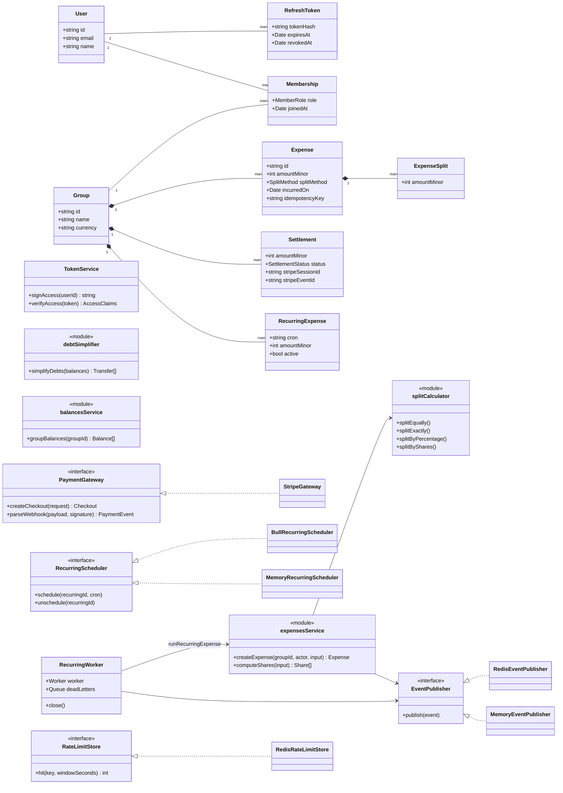

# Class diagram

The data model (top) mirrors `apps/api/prisma/schema.prisma`. The services (bottom) use the names in `apps/api/src`; plain function modules are shown as `<<module>>`.

Every interface has an in-memory or fake implementation for the tests (`MemoryEventPublisher`, `MemoryRecurringScheduler`, `MemoryRateLimitStore`, `FakeStripeGateway`).
