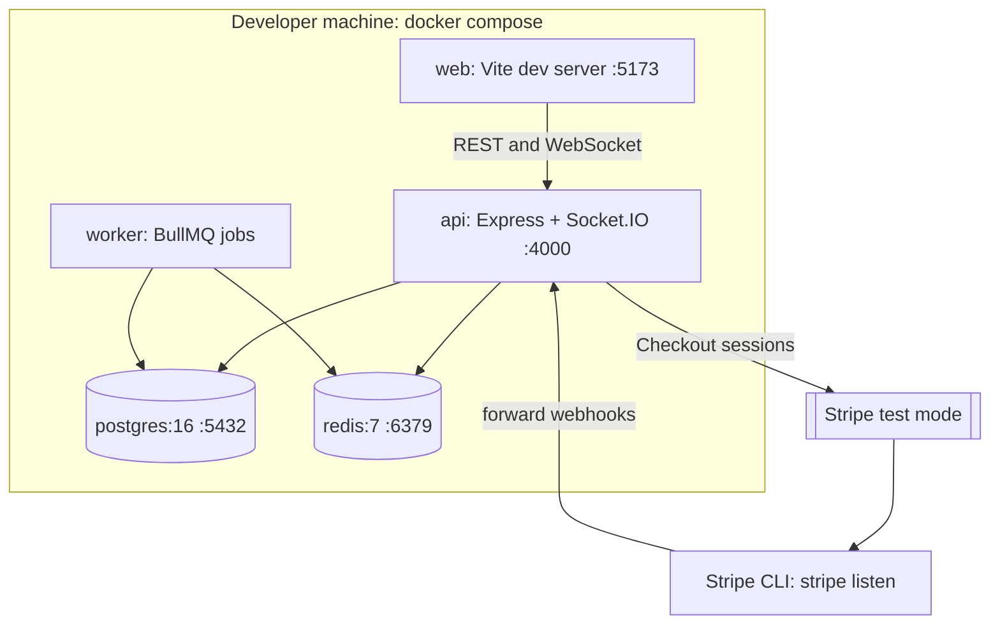

# Deployment view (local, Docker Compose)

Recurring jobs that fail 5 times land in the `recurring-expenses-dlq` BullMQ queue in the same Redis; `npm run dlq:replay` re-queues them.

Scaling path: run several `api` containers behind a load balancer. WebSocket clients connect with the websocket transport, so no sticky sessions are needed; every instance subscribes to the same Redis channel and delivers events to its own connected clients.
