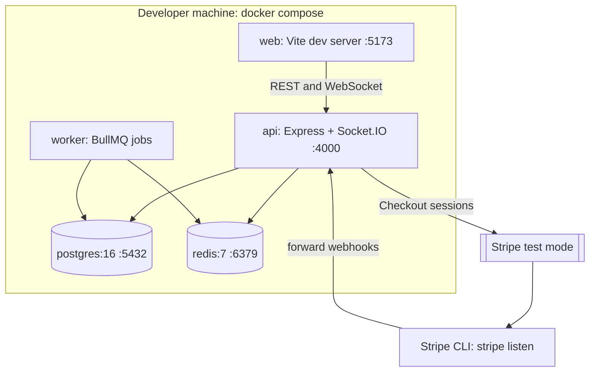

# Deployment view (local, Docker Compose)

Scaling path: run several `api` containers behind a load balancer with sticky sessions disabled; the Socket.IO Redis adapter keeps group rooms consistent across instances.
